# Практическая работа №3
## Подсистема безопасности Linux: пользователи, права, SSH, процессы

| | |
|---|---|
| **Студент** | Сафин Даниил Рустемович |
| **Дата** | 11.11.2026 |
| **Стенд** | Debian 13 в VirtualBox (хост ВМ `Debian23`, ядро 6.12.116+deb13-amd64), сеть NAT, проброс 127.0.0.1:2221 → 22 |
---

## Часть 1. Стенд и подключение по паролю

```bash
systemctl status ssh
ss -ltnp | grep ':22'
sudo apt install openssh-server          
sudo adduser drs-1
```

Проброс порта в VirtualBox (Настройки ВМ → Сеть → Дополнительно → Проброс портов): адрес хоста `127.0.0.1`, порт хоста `2221`, порт гостя `22`.

```
PermitRootLogin yes
MaxAuthTries 2
LoginGraceTime 30
```

```bash
sudo sshd -t                                                       
sudo sshd -T | grep -Ei '^(permitrootlogin|maxauthtries|logingracetime)'
sudo systemctl restart ssh
systemctl status ssh
ss -ltnp | grep ':22'
```


Подключения с основного компьютера (два окна терминала):

```powershell
ssh -p 2221 root@127.0.0.1
ssh -p 2221 drs-1@127.0.0.1
```

На ВМ:

```bash
who | tee -a otchet.txt
ss -tnp | grep ssh | tee -a otchet.txt
```


Копирование `scp` в обе стороны (у `scp` порт задаётся заглавной `-P`, у `ssh` — строчной `-p`):

```powershell
scp -P 2221 test.txt drs-1@127.0.0.1:/home/drs-1/          
scp -P 2221 drs-1@127.0.0.1:/etc/hostname ./hostname_vm   
```


---

## Часть 2. Пользователи и группы

### Скрипт `script31`

Скрипт проверяет число параметров и то, что они целые числа, проверяет права (нужен root), пропускает уже существующих пользователей, задаёт пароль через `chpasswd`.

```bash
#!/bin/bash
set -u

if [[ $# -ne 2 ]]; then
    echo "Usage: $0 <count> <start_number>" >&2
    exit 1
fi

if [[ $EUID -ne 0 ]]; then
    echo "Error: run as root" >&2
    exit 1
fi

COUNT="$1"
START="$2"

if ! [[ "$COUNT" =~ ^[0-9]+$ && "$START" =~ ^[0-9]+$ ]]; then
    echo "Error: parameters must be integers" >&2
    exit 1
fi

for (( i=0; i<COUNT; i++ )); do
    N=$(( START + i ))
    USER="u${N}"
    PASS="DerParol${N}"
    if id "$USER" >/dev/null 2>&1; then
        echo "User $USER already exists, skipping"
        continue
    fi
    useradd -m -s /bin/bash "$USER"
    echo "${USER}:${PASS}" | chpasswd
    echo "Created $USER"
done
```

Запуск и настройка группы:

```bash
chmod +x script31
sudo ./script31 5 1          
sudo ./script31 5 1            
sudo groupadd project
sudo usermod -aG project u1
sudo usermod -aG project u2
```


### Членство в группе и вывод `id`

Проверка членства командой `id`:

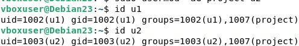

Одной командой вывести UID, GID и группы обоих пользователей можно так: `id u1 u2`.

### Записи в `/etc/passwd`, `/etc/group`, `/etc/shadow`

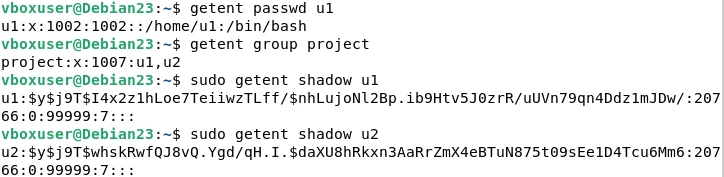

**Поля записи `/etc/passwd`** на примере `u1:x:1002:1002::/home/u1:/bin/bash`:

| № | Поле | Значение | Назначение |
|---|------|----------|------------|
| 1 | `u1` | имя | логин пользователя |
| 2 | `x` | пароль | `x` — хеш хранится в `/etc/shadow` |
| 3 | `1002` | UID | числовой идентификатор пользователя |
| 4 | `1002` | GID | числовой идентификатор основной группы |
| 5 | (пусто) | GECOS | комментарий: полное имя и т. п. |
| 6 | `/home/u1` | домашний каталог | |
| 7 | `/bin/bash` | шелл | программа, запускаемая при входе |

Запись группы `project:x:1007:u1,u2`: имя группы, `x` (пароля группы нет), GID 1007, список дополнительных членов (`u1`, `u2`).

**Сравнение записей `u1` и `u2` в `/etc/shadow`:** поля записи — имя; хеш пароля; дата последней смены пароля (дни с 01.01.1970, у обоих `20766`); минимальный срок (0); максимальный срок (99999); предупреждение за 7 дней; остальные поля пусты. Хеши обоих начинаются с `$y$j9T$` (алгоритм yescrypt с параметрами `j9T`), затем идут соль и сам хеш. У `u1` и `u2` пароли разные (`DerParol1`, `DerParol2`), поэтому разными получились и соль, и хеш; остальные поля совпадают. Даже при одинаковых паролях хеши различались бы из-за случайной соли (см. вопрос 3).

### Группа в открытой сессии и перелогин (п. 6)

Порядок: войти под `u3` (на терминале ВМ), `su - u1` и проверить `id`; затем добавить `u3` в `project` и проверить группы в уже открытой сессии `u3`; перелогиниться.

Сессия `u3`, открытая до добавления в группу: `groups` показывает только `u3`:

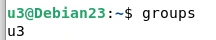

Последовательность из терминала: вход `su - u3` → `groups` (только `u3`) → `exit` → `sudo usermod -aG project u3` → новый вход `su - u3` → `groups` (теперь `u3 project`):

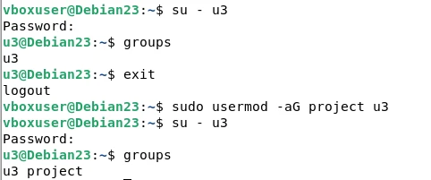

**Почему в открытой сессии группа не появляется.** Список групп процесса ядро получает при входе (`login`/`su` вызывают `initgroups`) и наследует его все дочерние процессы сессии. `usermod` меняет только файл `/etc/group`; уже работающие процессы свой список групп не перечитывают. Новый вход заново читает базу групп, поэтому `project` появился.

---

## Часть 3. Права на файлы и каталоги

### 3.1. Каталог `/DATA`

Группа `project` — владелец каталога с правами `rwx`, остальные только `r-x`:

```bash
sudo mkdir /DATA
sudo chgrp project /DATA
sudo chmod 775 /DATA
```

Проверка: `u1` (в группе) создаёт файл; `u4` (вне группы) файл создать не может (`Permission denied`), но читает (`cat` отработал без ошибки):

```bash
sudo -u u1 touch /DATA/f1
sudo -u u4 touch /DATA/f4
sudo -u u4 cat /DATA/f1
```

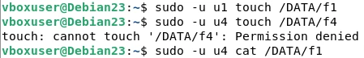

Права на каталог (`w` и `x`) позволяют членам группы создавать и удалять любые файлы в нём. Чтобы они могли ещё и *изменять* файлы друг друга, у самих файлов должна быть запись для группы (создавать файлы с `umask 002` или выставлять `chmod g+w`).

### 3.2. Каталог `/DATA/sec1` (sticky bit)

```bash
sudo mkdir /DATA/sec1
sudo chmod 1777 /DATA/sec1
sudo -u u1 touch /DATA/sec1/a
sudo -u u3 touch /DATA/sec1/b
sudo -u u1 rm /DATA/sec1/b          
```

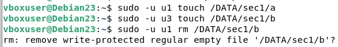

Записывать в каталог может любой пользователь. При попытке удалить чужой файл `b` `rm` сначала спрашивает подтверждение (у `u1` нет записи в этот файл); из-за sticky bit удаление чужого файла всё равно не пройдёт (`Operation not permitted`), удалить можно только свои файлы.


### 3.3. Каталог `/DATA/sec2`

`u1` — владелец (полный доступ), `u4` и `u5` — через группу `readers` только чтение, остальным доступ закрыт:

```bash
sudo groupadd readers
sudo usermod -aG readers u4
sudo usermod -aG readers u5
sudo mkdir /DATA/sec2
sudo chown u1:readers /DATA/sec2
sudo chmod 750 /DATA/sec2
sudo -u u1 touch /DATA/sec2/x
sudo -u u4 cat /DATA/sec2/x
sudo -u u5 cat /DATA/sec2/x
sudo -u u3 ls /DATA/sec2
```

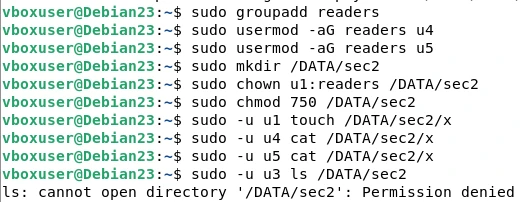

`u1` создал файл, `u4` и `u5` его читают, `u3` получает `Permission denied` даже на просмотр каталога.

### 3.4. Каталог `/DATA/sec3` и suid-копия `nano`

```bash
sudo mkdir /DATA/sec3
sudo cp /usr/bin/nano /DATA/sec3/nano
sudo chown u1:u1 /DATA/sec3/nano      
sudo chmod 4755 /DATA/sec3/nano      
sudo -u u3 /DATA/sec3/nano /DATA/sec2/x
```

Идея: запущенный любым пользователем `nano` исполняется с правами владельца `u1` (suid), поэтому может изменять файлы в `/DATA/sec2`.


### 3.5. suid-файлы в системе

```bash
find /usr/bin -perm -4000 -ls
```

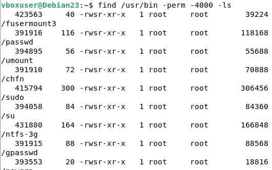

В списке есть `/usr/bin/passwd` (`-rwsr-xr-x root root`): ему нужен suid, чтобы обычный пользователь мог записать свой хеш в `/etc/shadow`. Если же владельцем копии редактора будет `root` с suid, любой пользователь получит редактор с правами root (см. вопрос 13).

### 3.6. Права созданных каталогов

```bash
ls -ld /DATA /DATA/sec1 /DATA/sec2 /DATA/sec3
```

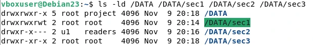

| Каталог | Символьно | Восьмеричные | Владелец:группа | Смысл |
|---|---|---|---|---|
| `/DATA` | `drwxrwxr-x` | 775 | root:project | группа project: rwx, остальные: r-x |
| `/DATA/sec1` | `drwxrwxrwt` | 1777 | root:root | все rwx; sticky bit — удалять/переименовывать только свои файлы |
| `/DATA/sec2` | `drwxr-x---` | 750 | u1:readers | u1: rwx; readers (u4, u5): r-x; остальные: ничего |
| `/DATA/sec3` | `drwxr-xr-x` | 755 | root:root | всем чтение и вход; внутри suid-копия nano |


---

## Часть 4. Аутентификация по ключам SSH

Ключ передаётся на основную учётную запись из предыдущих работ — `student-1`.

### 4.1. Создание пары ключей (основной компьютер, Windows PowerShell)

```powershell
ssh-keygen -t ed25519
```

Задана парольная фраза. Закрытый ключ — `C:\Users\User\.ssh\id_ed25519`, открытый — `C:\Users\User\.ssh\id_ed25519.pub`:

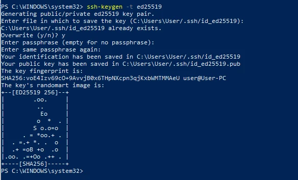

### 4.2. Установка открытого ключа на ВМ

Открытый ключ передан на ВМ в домашний каталог `student-1`, добавлен в `authorized_keys`, права выставлены (`~/.ssh` — 700, `authorized_keys` — 600), временный файл удалён:

```bash
mkdir -p ~/.ssh
chmod 700 ~/.ssh
cat ~/id_ed25519.pub >> ~/.ssh/authorized_keys
chmod 600 ~/.ssh/authorized_keys
rm ~/id_ed25519.pub
```

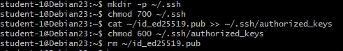

Права 700/600 нужны, потому что при `StrictModes` `sshd` отвергает ключ, если каталог или файл доступны для записи другим пользователям: те могли бы подменить ключ.

### 4.3. Конфигурация sshd

Изменённые параметры в `/etc/ssh/sshd_config`:

```
PermitRootLogin no
PubkeyAuthentication yes
AuthorizedKeysFile .ssh/authorized_keys
PasswordAuthentication no
```

```bash
sudo sshd -t
sudo sshd -T | grep -Ei '^(permitrootlogin|pubkeyauthentication|authorizedkeysfile|passwordauthentication)'
sudo systemctl restart ssh
```


### 4.4. Проверки входа

```powershell
ssh -p 2221 student-1@127.0.0.1                                 
ssh -p 2221 root@127.0.0.1                                      
ssh -p 2221 -o PubkeyAuthentication=no student-1@127.0.0.1      
```

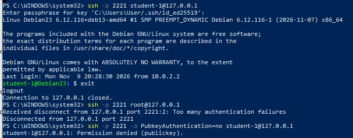

- Вход `student-1` по ключу работает (запрошена парольная фраза ключа, затем приглашение `student-1@Debian23`).
- Вход `root` не состоялся: сервер закрыл соединение (`Too many authentication failures`, т. к. `MaxAuthTries 2`, а `PermitRootLogin no`).
- Вход по паролю отклонён: `Permission denied (publickey)`.

### 4.5. Копирование с ВМ по ключу

```powershell
scp -P 2221 student-1@127.0.0.1:/home/student-1/script31 ./
```

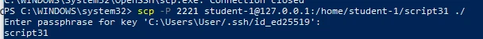

---

## Часть 5. su, sudo, процессы и фоновый запуск

### 5.1. sudo, su и `su -`

```bash
which sudo || sudo apt install sudo
sudo usermod -aG sudo drs-1
# новый вход под drs-1:
sudo -l
sudo id                                     
su -c 'pwd; echo $HOME; env | head'        
su - -c 'pwd; echo $HOME; env | head'       
```


### 5.2. Правило sudo для `u1`

Файл `/etc/sudoers.d/u1`, создан через `visudo -f /etc/sudoers.d/u1`:

```
u1 ALL=(root) /usr/bin/passwd [A-Za-z]*, !/usr/bin/passwd root, !/usr/bin/passwd *root*
```


Проверка файла утилитой `visudo -c`: на скриншоте первая проверка показала неверные права на файл (`/etc/sudoers.d/u1: bad permissions, should be mode 0440`):

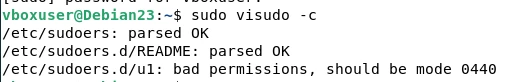

Исправление: файл в `sudoers.d` должен иметь права 0440 (чтение только для root и группы root):

```bash
sudo chmod 0440 /etc/sudoers.d/u1
sudo visudo -c
ls -l /etc/sudoers.d/u1
```


### 5.3. Проверка ограничений

```bash
sudo -u u1 sudo passwd u2
sudo -u u1 sudo passwd root
sudo -u u1 sudo ls /root
```

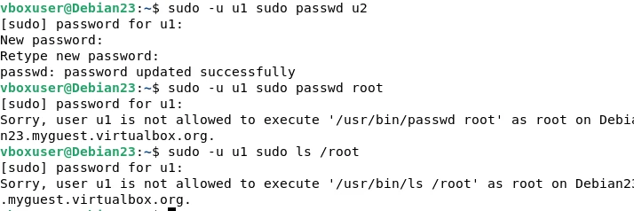

- `sudo passwd u2` под `u1` работает: пароль `u2` изменён (`password updated successfully`).
- `sudo passwd root` и `sudo ls /root` отклонены: `Sorry, user u1 is not allowed to execute '…' as root`.


### 5.4. htop

```bash
sudo apt install htop
htop        # F6 — сортировка (MEM%), F5 — дерево, F4/F3 — фильтр/поиск (sshd), F10 — выход
```

Меню выбора сортировки (F6), выбран столбец `PERCENT_MEM`:

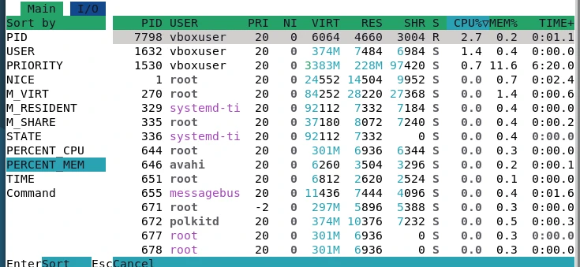


### 5.5. Цепочка родитель — потомок

```bash
ps -eo pid,ppid,user,stat,cmd
pstree -sp $$
```

Вывод `pstree -sp $$`:

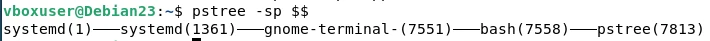

Цепочка от оболочки до PID 1 (по PPID): `bash (7558)` ← `gnome-terminal- (7551)` ← `systemd (1361)`, пользовательский менеджер ← `systemd (1)`. Родитель оболочки — процесс эмулятора терминала `gnome-terminal`; при входе по SSH на его месте был бы процесс `sshd: <пользователь>@pts/N`.


### 5.6. Сигналы SIGTERM и SIGKILL

Во второй сессии запущен `sleep 600`; в первой найден его PID (`pgrep -a sleep`, `ps -o pid,ppid,stat,cmd -C sleep`) и отправлен `SIGTERM`:

```bash
kill -TERM 7848
```

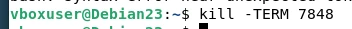

Во второй сессии процесс завершился штатно (`Terminated`):

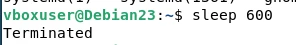


**Различие:** `SIGTERM` (15) — вежливая просьба завершиться, процесс может перехватить сигнал, закрыть файлы и завершиться сам (оболочка пишет `Terminated`). `SIGKILL` (9) ядро исполняет принудительно, перехватить или игнорировать его нельзя (оболочка пишет `Killed`).

### 5.7. SIGSTOP и SIGCONT

```bash
sleep 600 &
kill -STOP <PID>; ps -o pid,stat,cmd -p <PID>     
kill -CONT <PID>; ps -o pid,stat,cmd -p <PID>     
kill <PID>
```


### 5.8. Скрипт `script32`

```bash
#!/bin/bash
# script32 — раз в 2 секунды дописывает в ~/script32.log время, свой PID и PPID
while true; do
    echo "$(date '+%F %T') PID=$$ PPID=$PPID" >> ~/script32.log
    sleep 2
done
```

Фоновые задания:

```bash
chmod +x script32
./script32 &       # [1] <PID>
jobs
echo $!
fg                 # затем Ctrl+Z → [1]+ Stopped
bg                 # продолжение в фоне
kill %1            # завершение
```


### 5.9. SIGHUP: запуск с `&` и с `nohup`

```bash
# вариант 1: ssh → ./script32 & → exit
# вариант 2: ssh → nohup ./script32 & → exit
# во второй сессии:
ps -ef | grep script32
tail -3 ~/script32.log
ps -o pid,ppid,cmd -C script32
pkill -f script32        # по окончании
```


---

## Часть 6. Скрипт `script_passport_v3.sh`

Выполнен рефакторинг по этапам «сбор → отчёт → лог».

- **Функции:** `check_privileges`, `check_tool`, `write_section`, `log_run`, `usage`, `die`, `cleanup`, а также `run_priv`, `dmi`, `last_login`, `pass_change`, `prepare_dirs`, `collect_*` для каждого этапа сбора. Повторяющихся фрагментов, оформленных функциями, больше пяти.
- **Права:** `check_privileges` определяет root, либо пользователя из группы `sudo` с рабочим `sudo` (`sudo -v`), иначе сообщает об отсутствии прав и завершается с кодом 2 (код 3 — `sudo` не работает). Команды через `sudo` вызываются только функцией `run_priv` и только когда скрипт не от root.
- **Временные файлы:** `cleanup` вызывается через `trap … EXIT`, поэтому `.tmp` удаляются при любом завершении, включая Ctrl+C (`INT`/`TERM` → `exit 130` → `EXIT`).
- **Параметры:** `-h` — справка, `-o файл` — имя отчёта (по умолчанию `PASSPORT/inventory.txt`).
- **Новые разделы:** «Пользователи», «Параметры sshd» (эффективные значения из `sshd -T` и пометка «задан явно / по умолчанию»), «Топ-5 процессов по памяти», «Подозрительные учётные записи», «Файлы с suid».
- **Лог:** строка с датой, версией формата отчёта `v3`, режимом запуска и именем отчёта.

Для данных об оборудовании и входах нужны пакеты: `sudo apt install pciutils dmidecode lastlog2` (после установки `lastlog2` — перезагрузка). Если утилиты нет, раздел содержит «нет данных».

```bash
#!/bin/bash

FORMAT_VERSION="v3"
DEFAULT_REPORT="PASSPORT/inventory.txt"
LOG_FILE="PASSPORT/log/report.log"
TMP_DIR="PASSPORT/tmp"

die() {
    echo "Error: $*" >&2
    exit 1
}

cleanup() {
    if [ -d "$TMP_DIR" ]; then
        find "$TMP_DIR" -name "*.tmp" -delete
    fi
}
trap cleanup EXIT INT TERM

usage() {
    echo "Usage: $0 [-h] [report_file]"
    echo "  -h              Show this help message"
    echo "  report_file     Path to output report (default: $DEFAULT_REPORT)"
    exit 0
}

check_privileges() {
    if [ "$EUID" -ne 0 ]; then
        if command -v sudo >/dev/null 2>&1 && sudo -n true 2>/dev/null; then
            SUDO="sudo"
            PRIV_MODE="sudo"
        else
            die "Root privileges required. Run as root or via sudo."
        fi
    else
        SUDO=""
        PRIV_MODE="root"
    fi
}

check_tool() {
    local tool=$1
    local pkg=$2
    if ! command -v "$tool" >/dev/null 2>&1; then
        echo "Warning: tool '$tool' not found. Please install package '$pkg'." >&2
        return 1
    fi
    return 0
}

log_run() {
    mkdir -p "$(dirname "$LOG_FILE")"
    echo "Script run: $(date '+%Y-%m-%d %H:%M:%S') | Format: $FORMAT_VERSION | Report: $REPORT_FILE" >> "$LOG_FILE"
}

write_section() {
    local title=$1
    local file=$2
    {
        echo ""
        echo "=== $title ==="
        if [ -s "$file" ]; then
            cat "$file"
        else
            echo "No data available."
        fi
    } >> "$REPORT_FILE"
}

REPORT_FILE="$DEFAULT_REPORT"
while getopts "h" opt; do
    case $opt in
        h) usage ;;
        *) usage ;;
    esac
done
shift $((OPTIND - 1))
if [ $# -ge 1 ]; then
    REPORT_FILE="$1"
fi

check_privileges
mkdir -p "$TMP_DIR"
mkdir -p "$(dirname "$REPORT_FILE")"

{
    echo "=== SYSTEM PASSPORT (Version: $FORMAT_VERSION) ==="
    echo "Date: $(date)"
    echo "Host: $(hostname)"
    echo "User: $(whoami)"
    echo "Privilege mode: $PRIV_MODE"
} > "$REPORT_FILE"

echo "Collecting user data..."
: > "$TMP_DIR/users.tmp"
while IFS=: read -r name pass uid gid gecos home shell; do
    if [ "$uid" -eq 0 ] || [ "$uid" -ge 1000 ]; then
        groups=$($SUDO id -nG "$name" 2>/dev/null | tr ' ' ',')
        
        if command -v lastlog2 >/dev/null 2>&1; then
            last_login=$($SUDO lastlog2 -u "$name" 2>/dev/null | tail -n 1 | awk '{$1="";$2=""; print $0}' | sed 's/^ *//')
        else
            last_login=$($SUDO last -n 1 "$name" 2>/dev/null | head -n 1 | awk '{print $4, $5, $6, $7}')
        fi
        [ -z "$last_login" ] && last_login="No data"

        if command -v chage >/dev/null 2>&1; then
            pwd_change=$($SUDO LC_ALL=C chage -l "$name" 2>/dev/null | grep -i "Last password change" | cut -d: -f2 | sed 's/^ *//')
        else
            pwd_change="No data"
        fi
        [ -z "$pwd_change" ] && pwd_change="No data"

        echo "Name: $name | UID: $uid | Groups: $groups | Last login: $last_login | Password change: $pwd_change" >> "$TMP_DIR/users.tmp"
    fi
done < <(getent passwd)
write_section "Users" "$TMP_DIR/users.tmp"

echo "Collecting sshd parameters..."
if check_tool sshd "openssh-server"; then
    $SUDO sshd -T 2>/dev/null | grep -Ei '^(permitrootlogin|port|logingracetime|maxauthtries|passwordauthentication|pubkeyauthentication) ' > "$TMP_DIR/sshd.tmp"
    
    CONFIG_FILES=$(find /etc/ssh/sshd_config /etc/ssh/sshd_config.d/ -type f 2>/dev/null)
    : > "$TMP_DIR/sshd_explicit.tmp"
    while read -r line; do
        param=$(echo "$line" | awk '{print $1}')
        if grep -qiE "^[[:space:]]*$param" $CONFIG_FILES 2>/dev/null; then
            echo "$line (explicitly set)" >> "$TMP_DIR/sshd_explicit.tmp"
        else
            echo "$line (default)" >> "$TMP_DIR/sshd_explicit.tmp"
        fi
    done < "$TMP_DIR/sshd.tmp"
    write_section "sshd parameters" "$TMP_DIR/sshd_explicit.tmp"
else
    echo "sshd not found." > "$TMP_DIR/sshd.tmp"
    write_section "sshd parameters" "$TMP_DIR/sshd.tmp"
fi

echo "Analyzing processes..."
ps -eo pid,ppid,user,pmem,comm --sort=-pmem | head -n 6 > "$TMP_DIR/top.tmp"
write_section "Top-5 processes by memory" "$TMP_DIR/top.tmp"

echo "Checking for suspicious accounts..."
: > "$TMP_DIR/suspicious.tmp"
if [ -r /etc/shadow ]; then
    $SUDO awk -F: '$2=="" {print "Empty password: " $1}' /etc/shadow >> "$TMP_DIR/suspicious.tmp"
    awk -F: '$3==0 && $1!="root" {print "UID 0 (non-root): " $1}' /etc/passwd >> "$TMP_DIR/suspicious.tmp"
else
    echo "No permission to read /etc/shadow" >> "$TMP_DIR/suspicious.tmp"
fi
write_section "Suspicious accounts" "$TMP_DIR/suspicious.tmp"

echo "Searching for SUID files..."
find /usr/bin /usr/sbin -type f -perm -4000 2>/dev/null > "$TMP_DIR/suid.tmp"
write_section "SUID files" "$TMP_DIR/suid.tmp"

log_run
echo "Report successfully generated: $REPORT_FILE"
echo "Log written to: $LOG_FILE""
```

Три проверки:

```bash
sudo ./script_passport_v3.sh           
./script_passport_v3.sh               
su - u3 -c ./script_passport_v3.sh      
./script_passport_v3.sh -h             
./script_passport_v3.sh -o /tmp/my.txt  
cat PASSPORT/log/report.log             
ls PASSPORT/tmp                         
```
>

**Сравнение `lastlog2` и `lslogins`.** `lastlog2` хранит историю входов в собственной базе (`/var/lib/lastlog/lastlog2.db`), её пишет PAM-модуль при входе; для новых учётных записей показывает, что входов не было. `lslogins` — сводка по учётным записям из `/etc/passwd`, `shadow` и журналов входов (`wtmp`/`btmp`): UID, группы, статус пароля, последний вход. Источником данных о последнем входе на Debian 13 выбран `lastlog2`, `lslogins` удобен для общей сводки по пользователям.

---

## Ответы на вопросы

**1. Зачем при создании SSH-ключа предлагается задать парольную фразу?**
Она шифрует закрытый ключ на диске. Если файл украдут (копия диска, вредоносное ПО, чужой доступ к компьютеру), без фразы им нельзя воспользоваться. Это защита от кражи и использования закрытого ключа: к «чем владеешь» (файл ключа) добавляется «что знаешь» (фраза).

**2. Зачем при первом подключении по SSH показывается отпечаток ключа сервера?**
Чтобы убедиться, что вы подключаетесь к настоящему серверу, а не к подставному (MITM, подмена DNS или IP). Принятый ключ сохраняется в `~/.ssh/known_hosts`. Если отпечаток изменится, клиент выдаст предупреждение `REMOTE HOST IDENTIFICATION HAS CHANGED` и откажется подключаться: возможна подмена сервера или ключ сервера был сменён (например, переустановка ОС).

**3. Если у двух пользователей одинаковые пароли, можно ли понять это по `/etc/shadow`?**
Нет. В хеш входит случайная соль, поэтому у одинаковых паролей разные записи (`$y$j9T$<соль>$<хеш>`). Это защищает от радужных таблиц и от обнаружения совпадающих паролей.

**4. Таблица атрибутов**

| Атрибут | Сокращённое название | Для файла | Для каталога |
|---|---|---|---|
| r | read | читать содержимое | получать список имён (`ls`) |
| w | write | изменять содержимое | создавать, переименовывать, удалять записи (только вместе с x) |
| x | execute | запускать как программу | входить (`cd`), обращаться к файлам по имени |
| suid (4000) | set user ID | запуск с правами владельца файла | обычно не действует |
| sgid (2000) | set group ID | запуск с правами группы-владельца | новые файлы наследуют группу каталога |
| sticky (1000) | sticky bit | обычно не действует | удалять и переименовывать файлы могут только владелец файла, владелец каталога и root |

**5. Почему для удаления файла нужны права на каталог? Что даёт sticky bit?**
Файл — это запись (имя → inode) в каталоге. Удаление меняет каталог, а не содержимое файла, поэтому нужны `w` и `x` на каталог. Sticky bit на каталоге ограничивает удаление и переименование: только владелец файла, владелец каталога или root (пример: `/tmp`, права 1777; на скриншоте — `/DATA/sec1`).

**6. Команда `setfacl`; как решить задание 3 с помощью ACL?**

```bash
setfacl -m u:username:rwx файл
```

Задание 3 с ACL:

```bash
mkdir /DATA/sec2
chown root:root /DATA/sec2
chmod 700 /DATA/sec2
setfacl -m u:u1:rwx,u:u4:rx,u:u5:rx /DATA/sec2
setfacl -d -m u:u1:rwx,u:u4:rx,u:u5:rx /DATA/sec2    
getfacl /DATA/sec2
```

Остальным права не даны (other = `---`), дополнительная группа `readers` не нужна.

**7. Чем различаются `su`, `su -` и `sudo`? Почему для повседневной работы рекомендуют `sudo`?**
`su` переключает на пользователя по его паролю, окружение в основном сохраняется. `su -` запускает полноценный login-шелл целевого пользователя (его `HOME`, `PATH`, переменные). `sudo` выполняет одну команду от имени другого пользователя, спрашивает пароль вызывающего и работает по правилам sudoers. Для повседневной работы `sudo` лучше: пароль root не раздаётся, права выдаются точечно (принцип наименьших привилегий), каждое действие журналируется, права отзываются удалением из группы без смены общего пароля.

**8. Удалось ли обойти ограничение sudo из Части 5? Чем опасны wildcard в sudoers?**
Прямые варианты закрыты (скриншот): `sudo passwd root` и `sudo ls /root` отклоняются, `sudo passwd u2` работает. Результат моей попытки обхода (несколько аргументов, опции) описан в разделе 5.3. Подстановка `*` в sudoers соответствует любой строке, включая пробелы, дополнительные аргументы и опции, поэтому правило вида `passwd *` разрешает комбинации, которых автор не предполагал (например, несколько имён в одной команде). Исключения со знаком `!` зависят от порядка правил (действует последнее совпадение) и не покрывают всех вариантов. Надёжнее — явные команды без wildcard или обёртка-скрипт с проверкой аргументов.

**9. Чем отличается SIGTERM от SIGKILL? Какой можно перехватить?**
`SIGTERM` (15) — просьба завершиться: процесс может перехватить сигнал, закрыть файлы, освободить ресурсы или проигнорировать. `SIGKILL` (9) ядро исполняет немедленно: перехватить, заблокировать или игнорировать его нельзя. Перехватить можно только `SIGTERM`.

**10. Что происходит с процессом из `&` при закрытии SSH-сессии? Почему `nohup` меняет поведение, а PPID — другой?**
Процесс из `&` остаётся в сессии оболочки; при закрытии сессии оболочка и терминал посылают ему `SIGHUP`, и по умолчанию он завершается. `nohup` запускает программу с игнорированием `SIGHUP` (вывод перенаправляется в `nohup.out`), поэтому она переживает закрытие сессии. PPID у процесса, запущенного в оболочке, — PID этой `bash`. После закрытия сессии `bash` завершается, осиротевший процесс «усыновляется» системным процессом — PID 1 или `systemd --user`; поэтому PPID у `nohup`-варианта становится другим.

**11. Что такое зомби-процесс? Можно ли его убить `kill -9`?**
Процесс, который завершился, но родитель ещё не прочитал его код возврата (`wait()`); в таблице процессов остаётся запись со статусом `Z`. `kill -9` не помогает: процесс уже мёртв, сигналу некому доставляться, ресурсов он не занимает, кроме записи в таблице. Зомби исчезает, когда родитель вызовет `wait` либо завершится (тогда зомби усыновляет init и подбирает).

**12. Чем отличается вывод `sshd -T` от строк `sshd_config`, найденных через `grep`?**
`sshd -T` показывает итоговую конфигурацию, которую реально использует сервер: с учётом значений по умолчанию, `Include` и файлов из `sshd_config.d`, правила «действует первое найденное значение» и параметров командной строки. `grep` показывает только текст файла, включая закомментированные строки. Примеры: в `sshd_config` строка `#PermitRootLogin prohibit-password` закомментирована, а `sshd -T` всё равно выводит `permitrootlogin without-password` (значение по умолчанию); параметр `Port` может отсутствовать в `grep`, а `sshd -T` покажет `port 22`; если во вложенном `sshd_config.d/*.conf` задано другое значение раньше, `sshd -T` покажет именно его.

**13. Какой риск, если владелец исполняемого файла — root и установлен suid?**
Файл запускается с правами root независимо от того, кто его вызвал. Любая уязвимость в программе или возможность запустить из неё команды/шелл (редакторы, интерпретаторы) приводит к получению root: чтение и запись `/etc/shadow`, `/etc/sudoers`, установка бэкдоров. Поэтому suid-root-файлов должно быть минимум, они должны быть проверены и находиться под аудитом (раздел «Файлы с suid» в отчёте инвентаризации).
